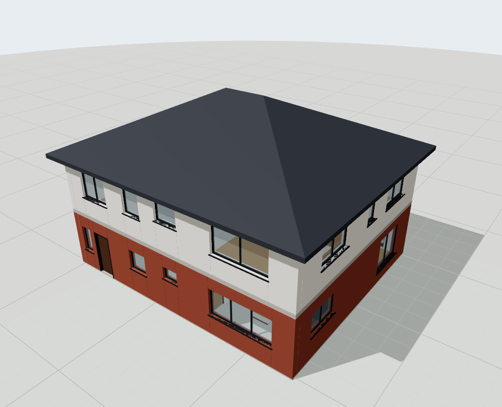
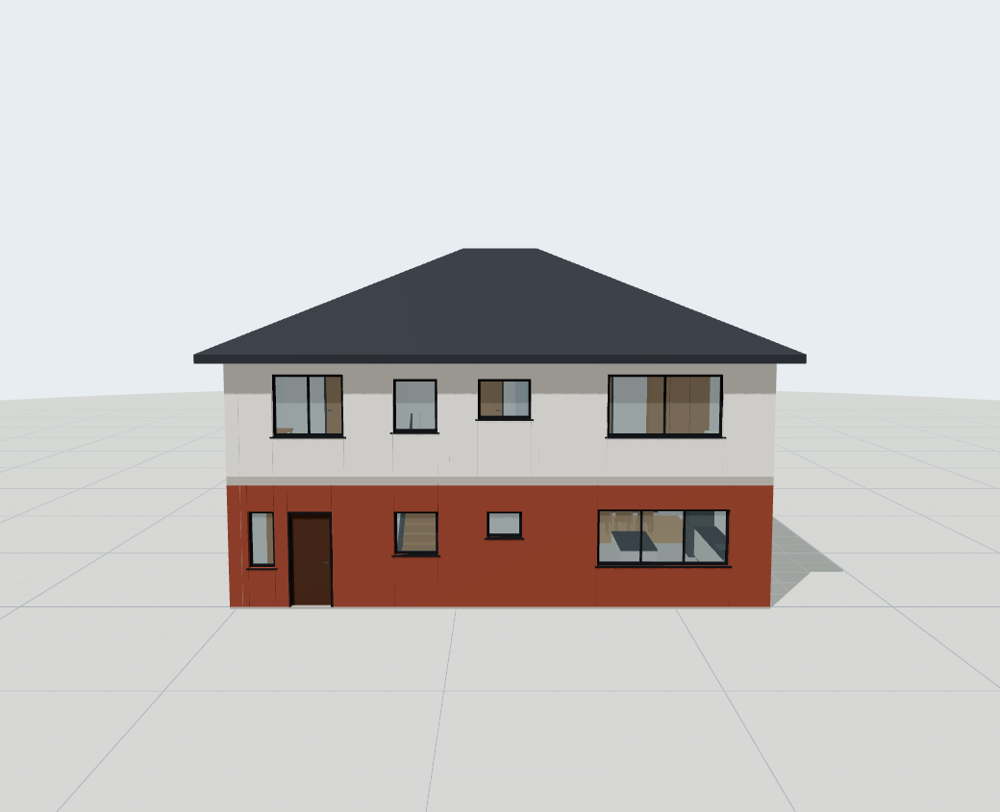
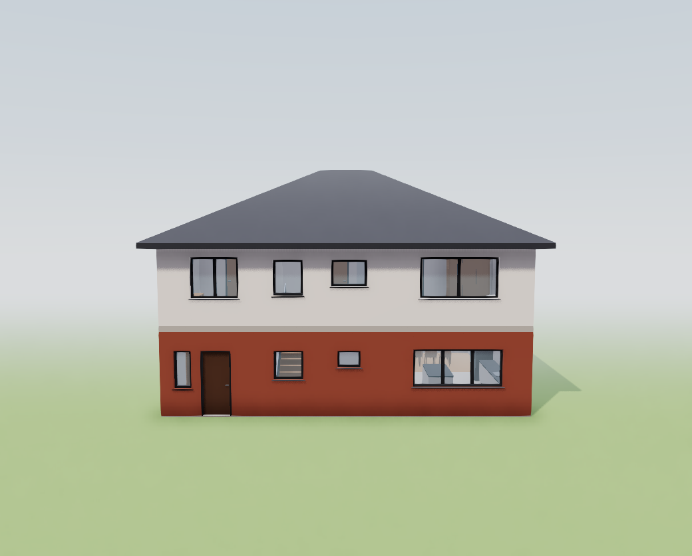
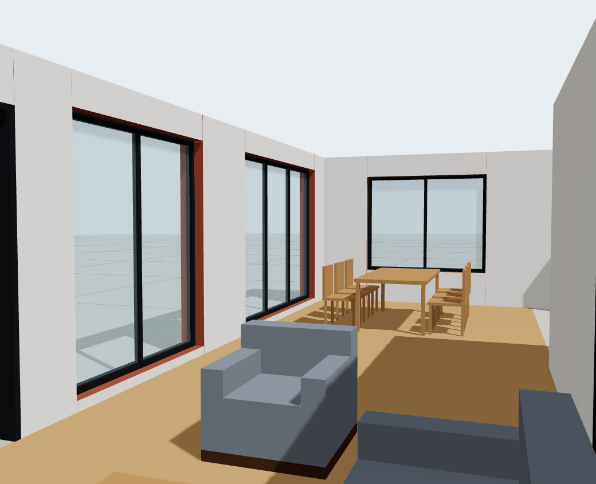
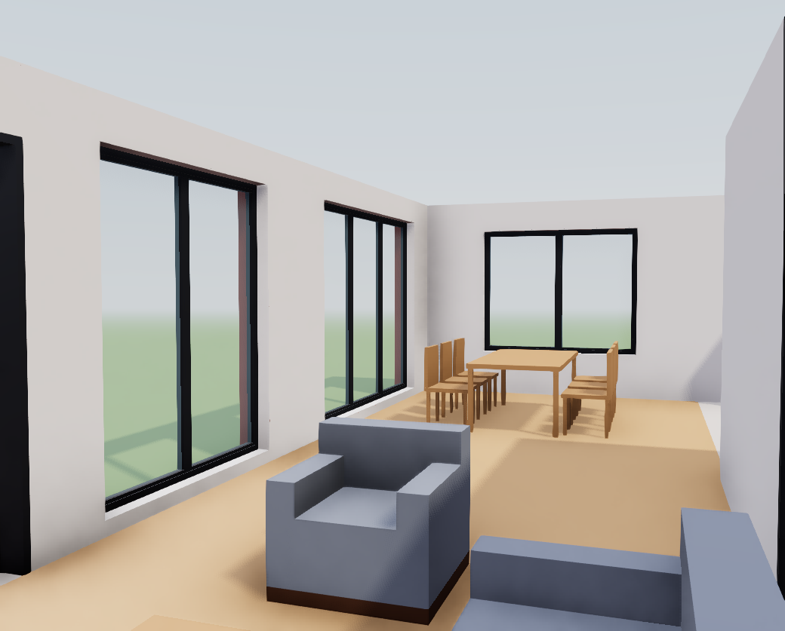

# Viewer screenshots — V1 visual quality (step 1)

Demo house (`/`, hand-authored fixture), headless Chromium (SwiftShader software WebGL),
1600×1000 window, canvas only, camera presets Exterior / Front / Interior. Captured 2026-10-31.

| View | Before (main) | After (`v1-visual-quality`) |
|---|---|---|
| Exterior |  |  |
| Front |  |  |
| Interior |  |  |

"After" uses the HDRI lighting, soft shadows, contact shadows, N8AO + SMAA, reflective glass,
window reveal linings, the site ground and sky. **No PBR texture files are shipped yet**
(asset hosts blocked in the build environment, see `data/materials/ASSETS.md`), so surfaces
show their flat library colours.
