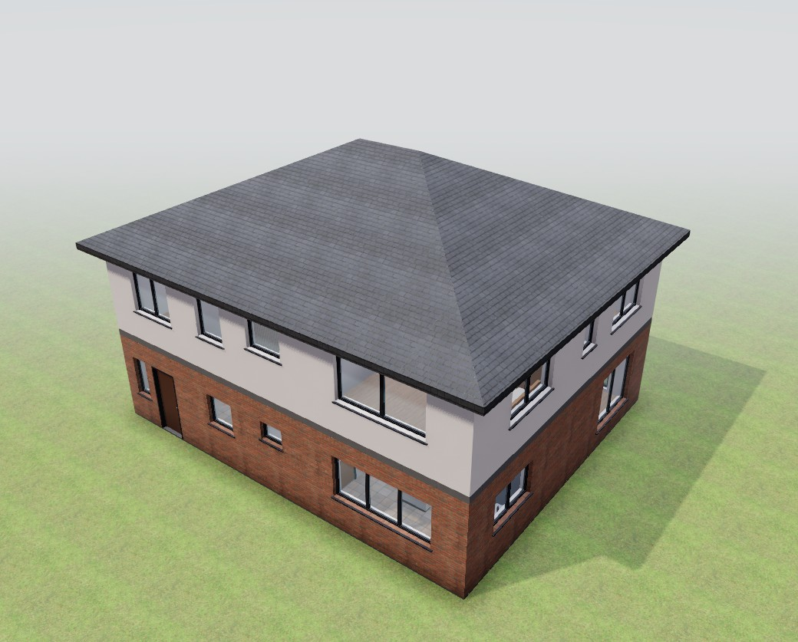
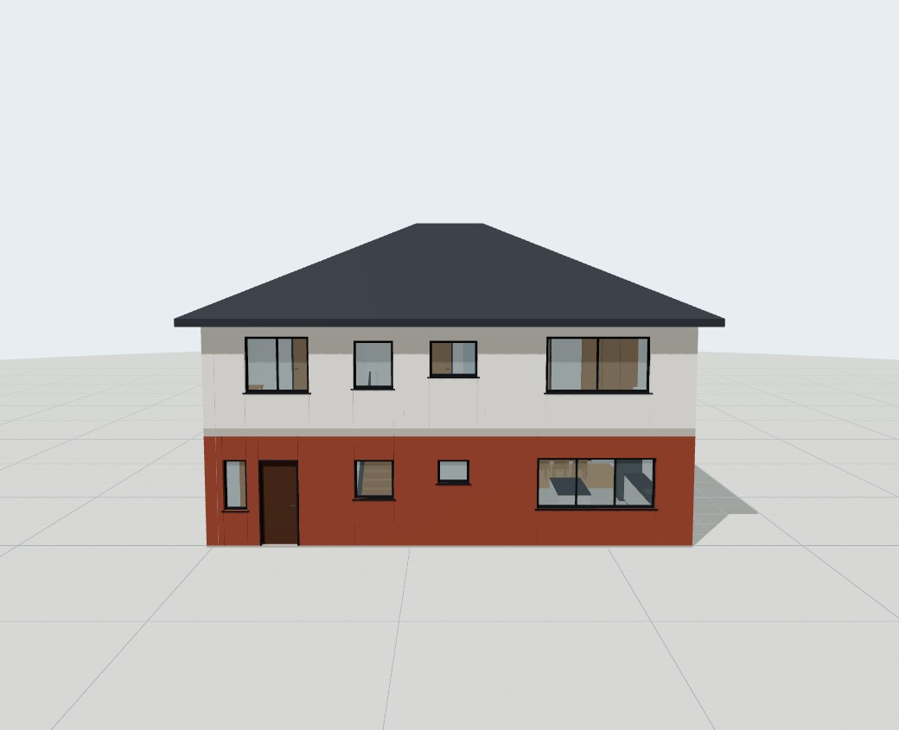
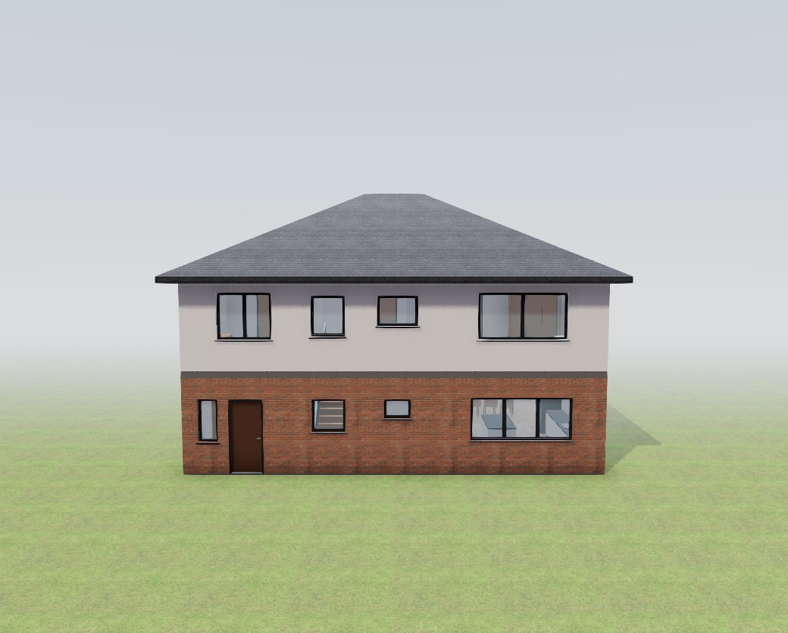
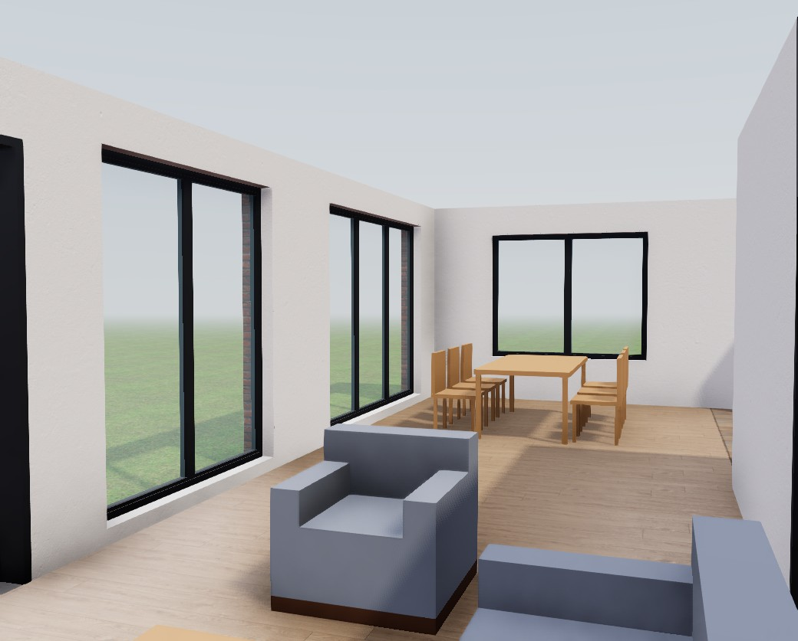
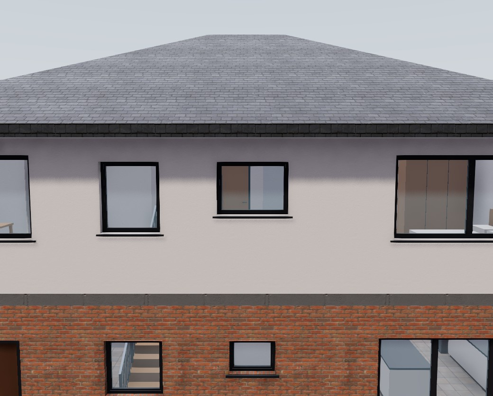
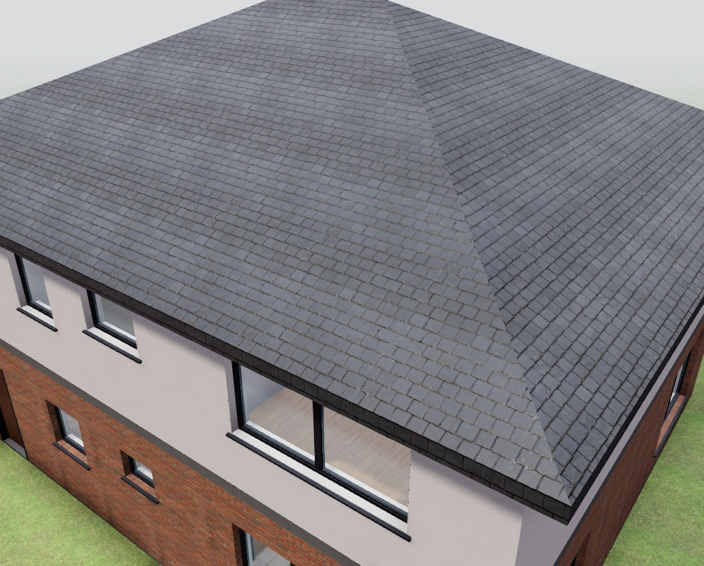
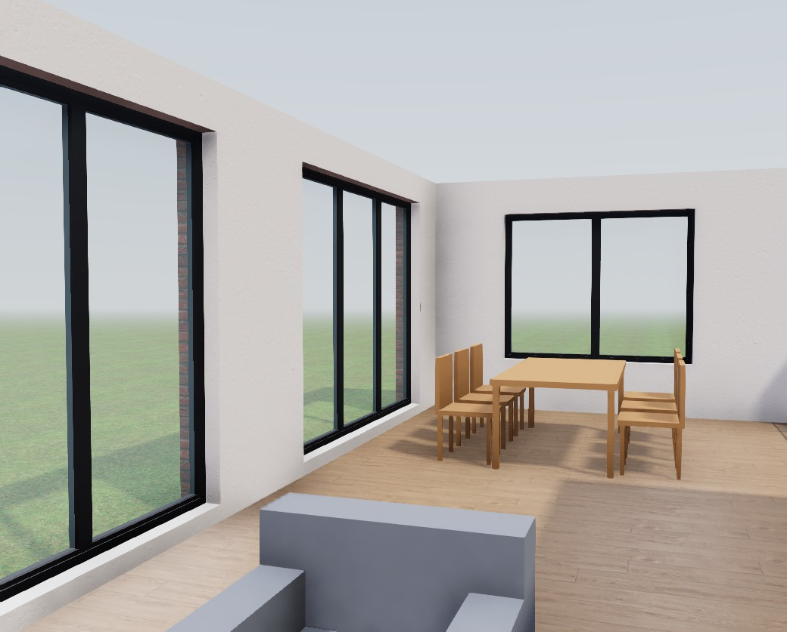

# Viewer screenshots — V1 visual quality (step 1)

Demo house (`/`, hand-authored fixture), headless Chromium with SwiftShader (software WebGL),
1600×1000 window, canvas only, camera presets Exterior / Front / Interior. Retaken 2026-11-01:
"before" from `main`, "after" from `v1-visual-quality` with the CC0 Poly Haven textures and HDRI
(`data/materials/ASSETS.md`). On a GPU, ambient occlusion and shadows are smoother than in
these software renders.

| View | Before (`main`) | After (`v1-visual-quality`) |
|---|---|---|
| Exterior |  |  |
| Front |  |  |
| Interior |  |  |

## Texture scale checks (after, zoomed in)

| Facade (brick, render) | Roof (slate, both slopes) | Floor (laminate) |
|---|---|---|
|  |  |  |

Brick courses ≈ 70 mm, slate courses ≈ 136 mm parallel to every eave, laminate boards ≈ 212 mm
(measured on the maps at the library's `tile_size_m`; UVs are in meters).
