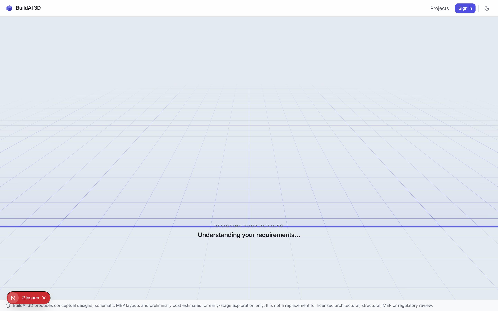
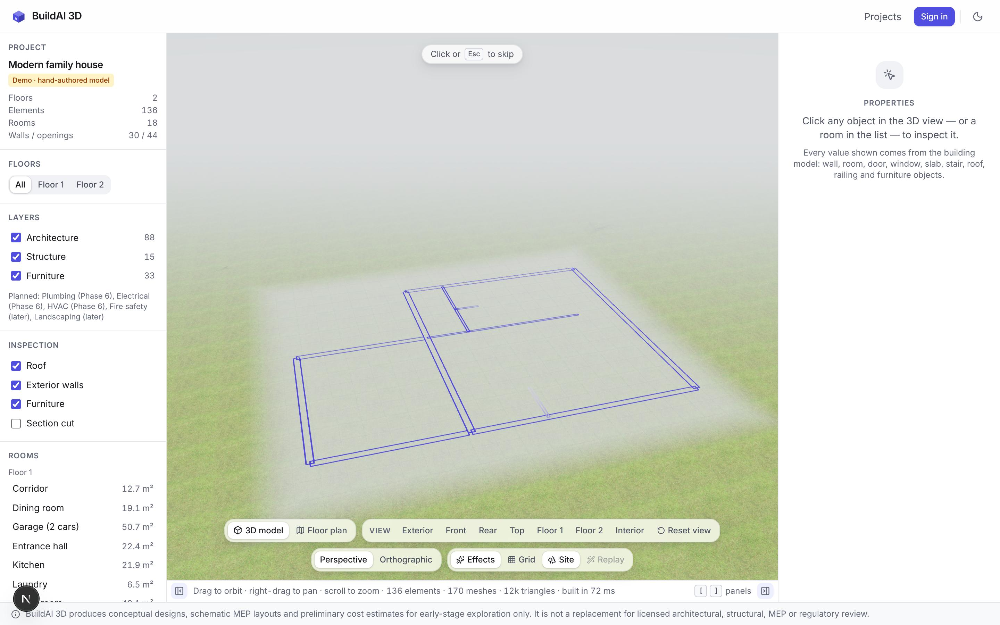
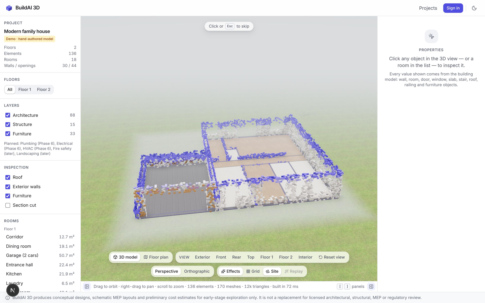
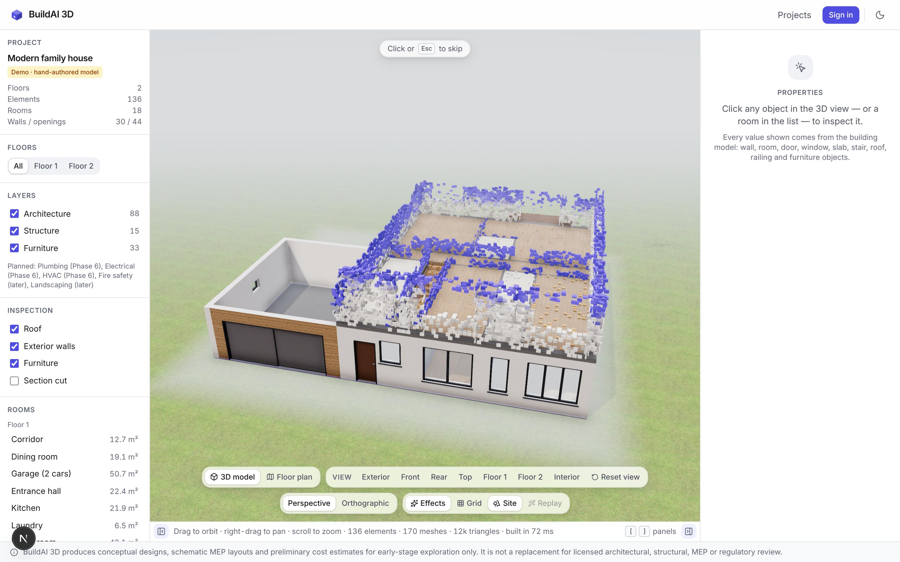
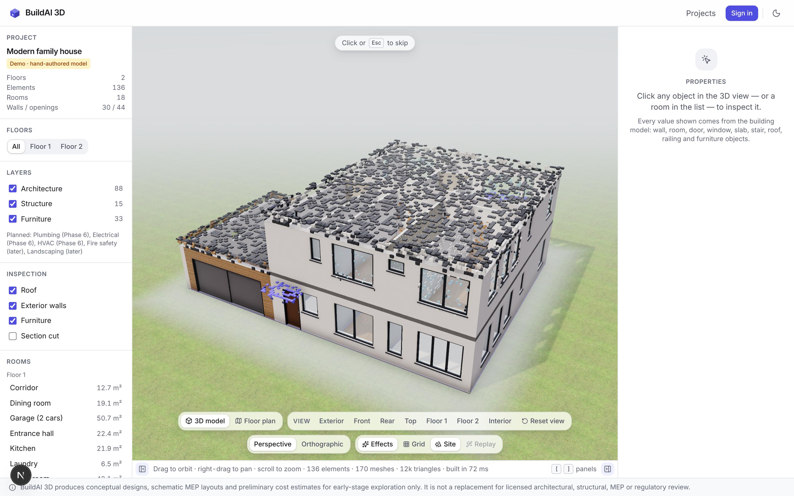
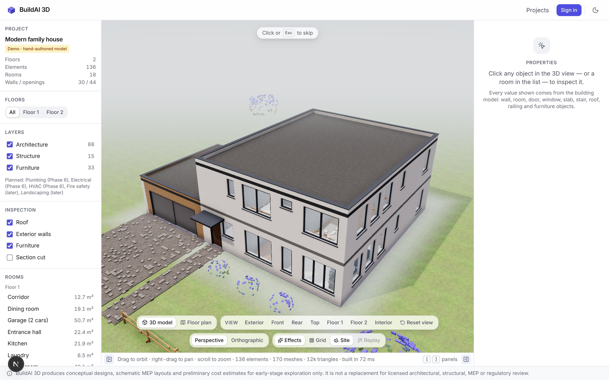
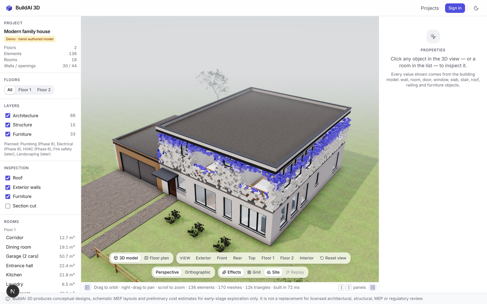
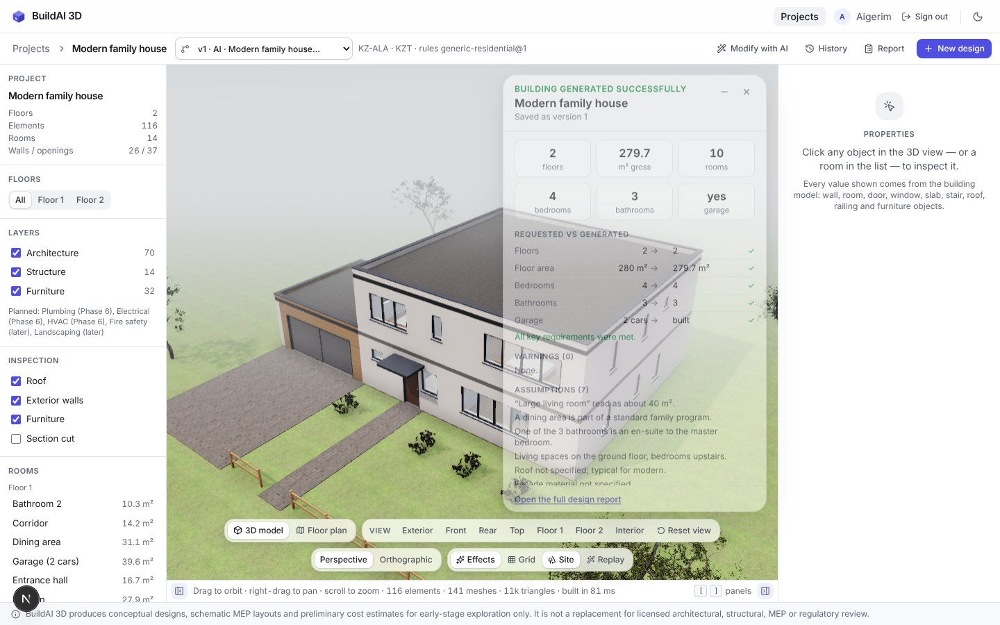
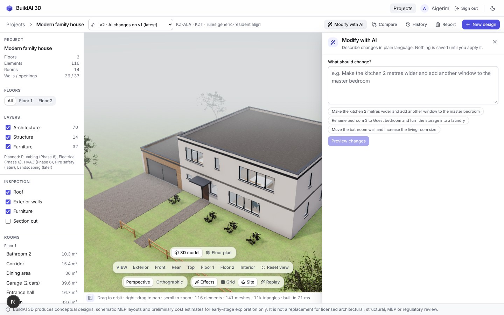

# Build reveal — screenshots

Headless Chromium (SwiftShader software WebGL), 1440×900 at 2×, branch `construction-reveal`,
the generated two-storey reference house (`data/fixtures/generated-house.model.json`) in the
demo editor. The round "N" badge is the Next.js dev-server indicator.

The assembly frames are the real effect paused at a fixed time with the dev-only
`window.__buildaiReveal.freeze(t)` (the whole build of this house takes 9 s); `changes` is
`freeze(1, ids)`. The waiting frame is `WaitingBlueprint` rendered on its own with a real stage
label (no backend in this environment).

| Phase | |
|---|---|
| Waiting — ground grid, scanning line, the real stage label |  |
| 0.7 s — the ground-floor plan draws itself |  |
| 2.6 s — ground storey: slab and floors done, walls rising course by course |  |
| 4.9 s — ground storey finished, the upper storey assembles |  |
| 6.5 s — roof and canopy |  |
| 7.9 s — furniture done, the site |  |
| After "Apply" in Modify with AI — only the changed elements re-assemble |  |
| Finished with the generation summary (from the first version, unchanged) |  |
| Toolbar with a drawer open (from the first version, unchanged) |  |
