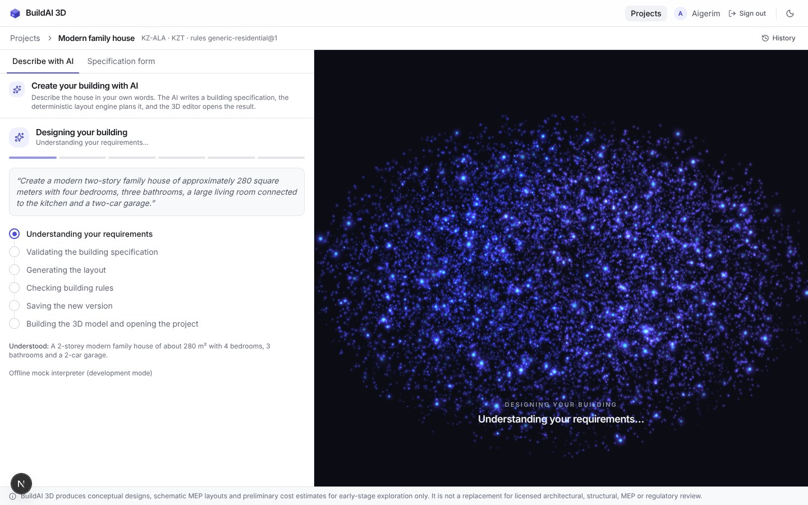
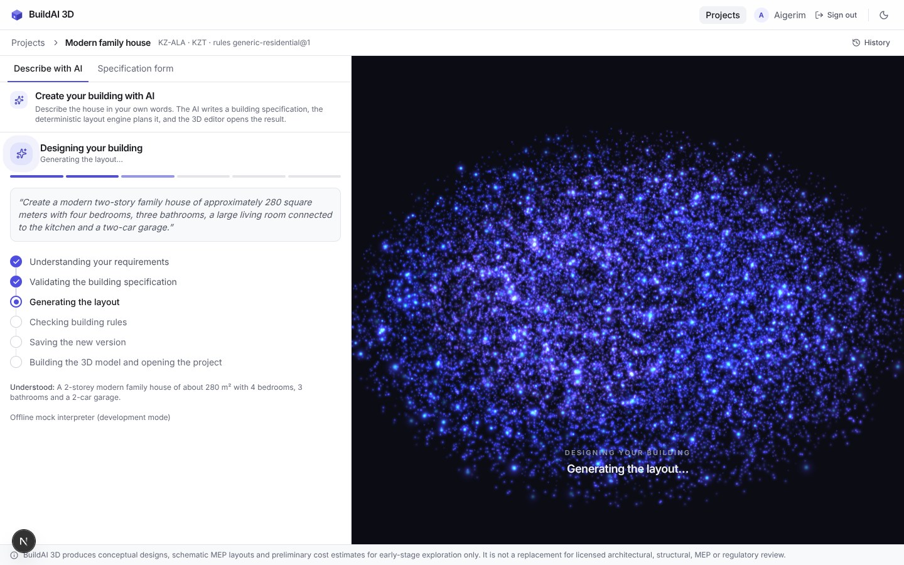
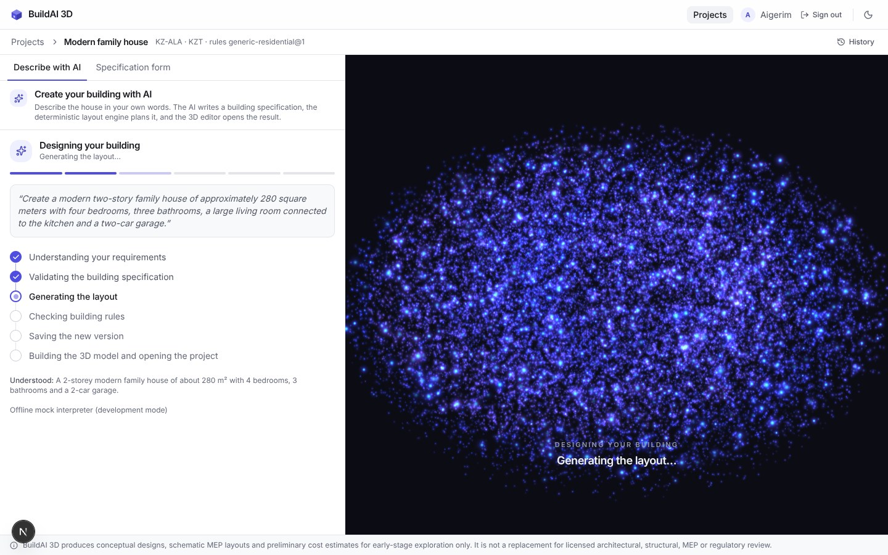
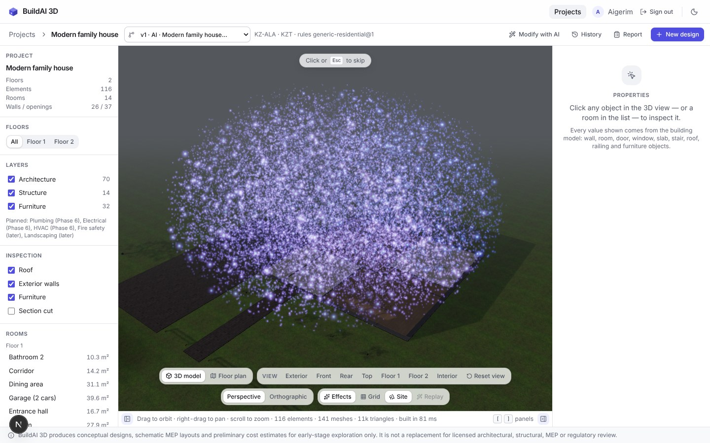
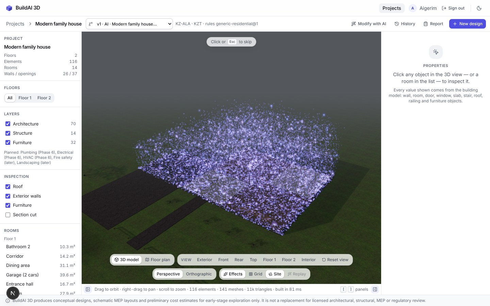
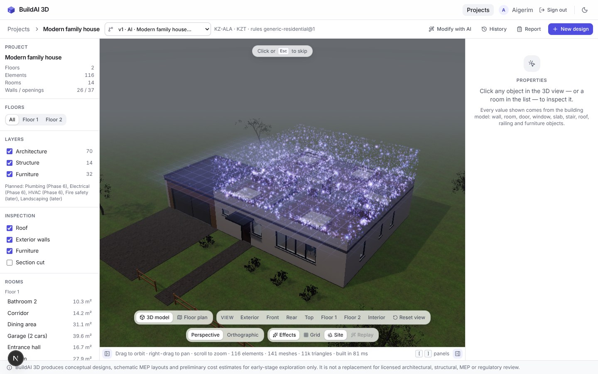
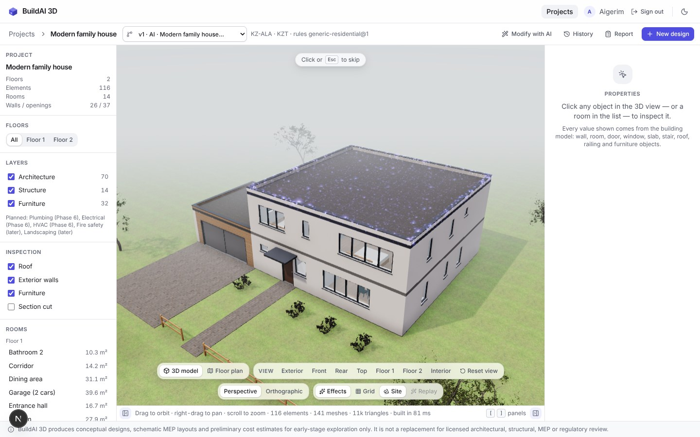
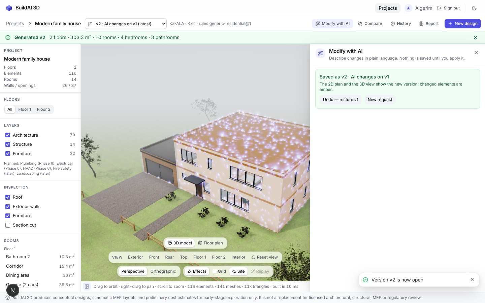

# Build reveal — screenshots

Headless Chromium (SwiftShader software WebGL), 1440×900, `generation-reveal`. A real AI
generation started from the prompt box (offline mock interpreter). The round "N" badge is the
Next.js dev-server indicator.

The waiting frames hold the generation's status response at a real backend stage (request
interception in the screenshot script only: the mock finishes too fast to capture). The assembly
frames are the real effect paused at a fixed time with the dev-only
`window.__buildaiReveal.freeze(t)`.

| Phase | |
|---|---|
| Waiting — stage "Understanding your requirements" |  |
| Waiting — the stage just changed to "Generating the layout" (burst, denser) |  |
| Waiting — "Generating the layout", settled |  |
| Assembly at 0.5 s — the cloud over the dark veil, first particles leaving |  |
| Assembly at 1.5 s — the lower storey has landed, the sweep starts |  |
| Assembly at 2.4 s — meshes revealed up to the sweep sheet, upper particles above it |  |
| Assembly at 3.0 s — veil lifted, the last particles fade on the roof |  |
| Finished (after skip / end) with the generation summary |  |
| After "Apply" in Modify with AI — changed elements sparkle |  |
| Toolbar with a drawer open — re-centred in the visible canvas, wrapped |  |
