# Viewer screenshots — V2 furniture and site

Demo house (`/`), headless Chromium with SwiftShader (software WebGL), 1600×1000 window, canvas
only. "Before" = `main` after V1 (taken on this branch before any V2 change), "after" =
`v2-furniture-site`. Poses: Exterior and Interior presets; bedroom (master, Floor 2), bathroom
(Floor 2) and the detail views use fixed model-space poses through the development-only
`window.__buildaiViewer.setPose` hook, so they are reproducible.

| View | Before | After |
|---|---|---|
| Exterior | 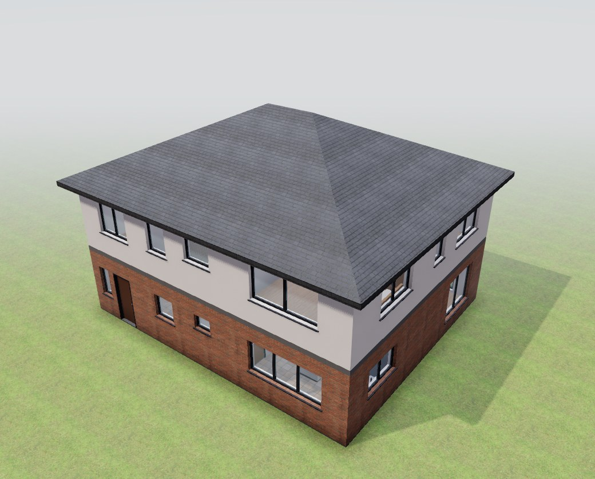 | 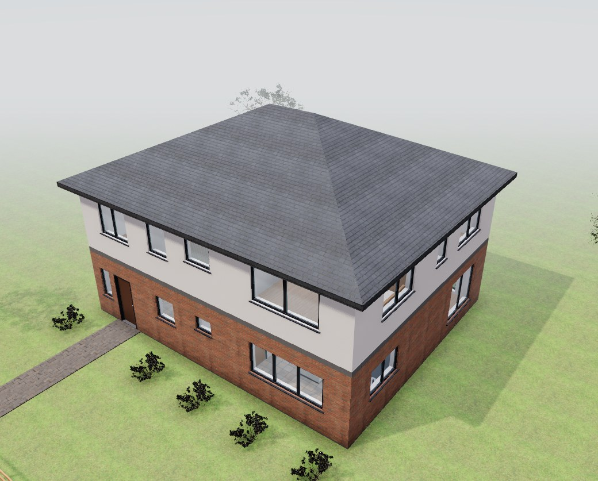 |
| Living room (Interior preset) | 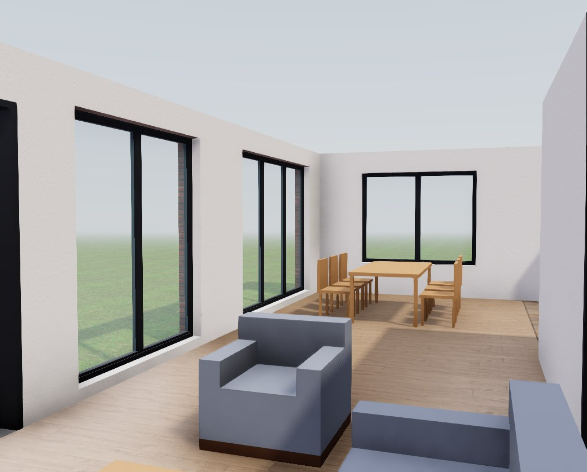 | 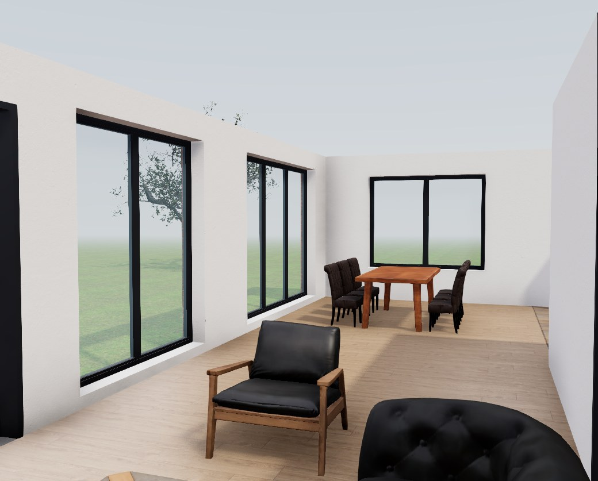 |
| Bedroom (master, Floor 2) | 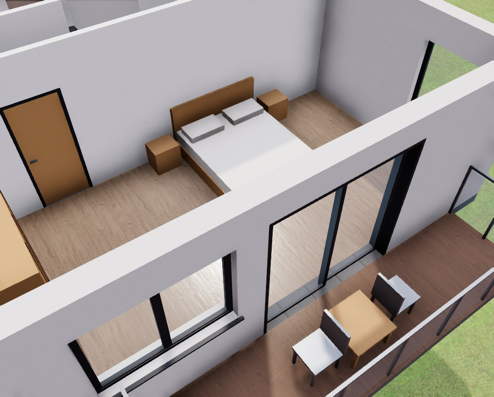 | 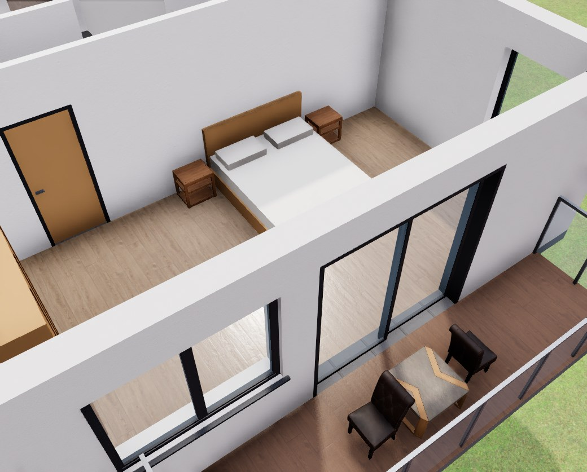 |
| Bathroom (Floor 2) | 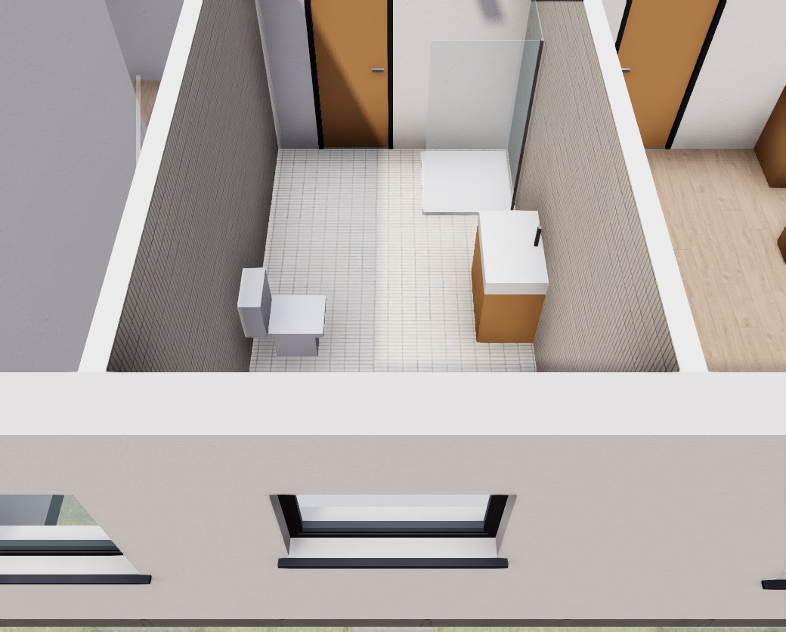 | 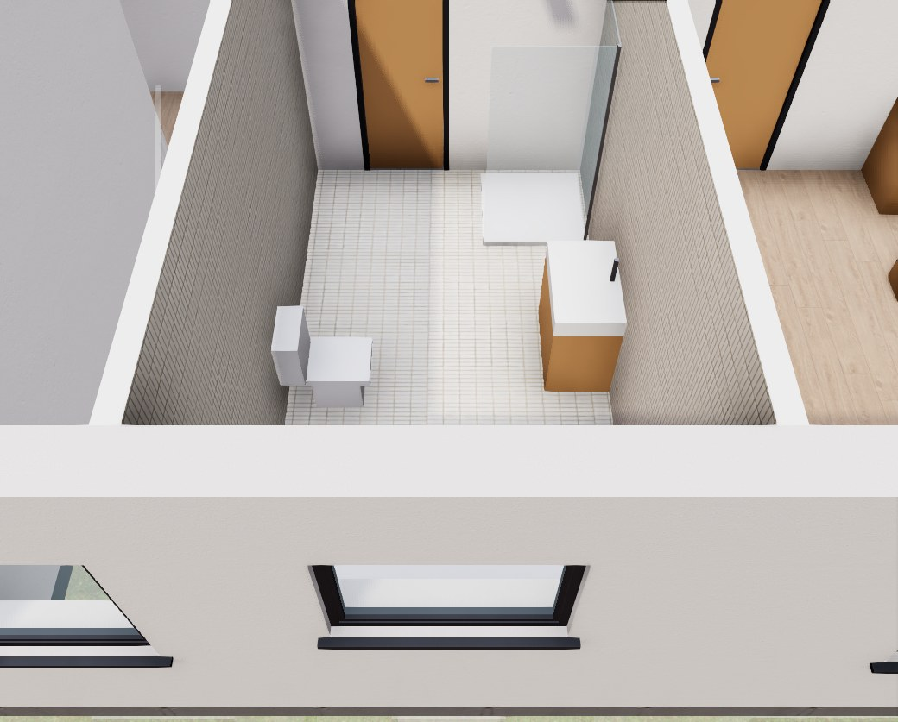 |
| Window reveal, living room | 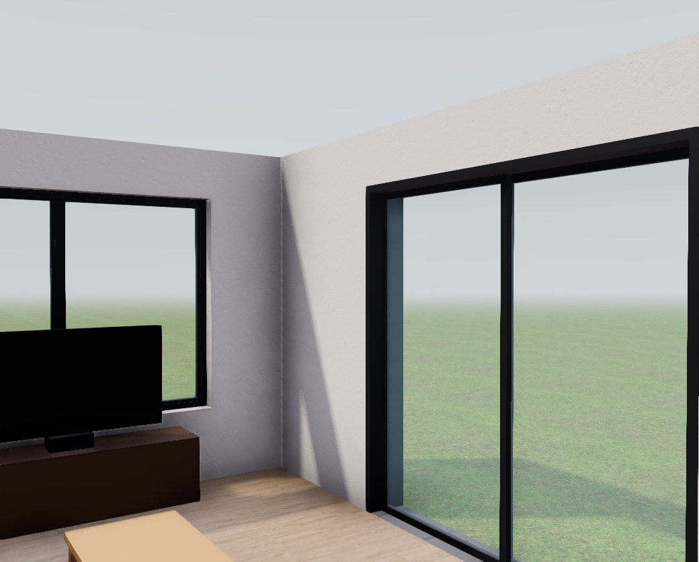 |  |
| Slab soffit, all floors shown | 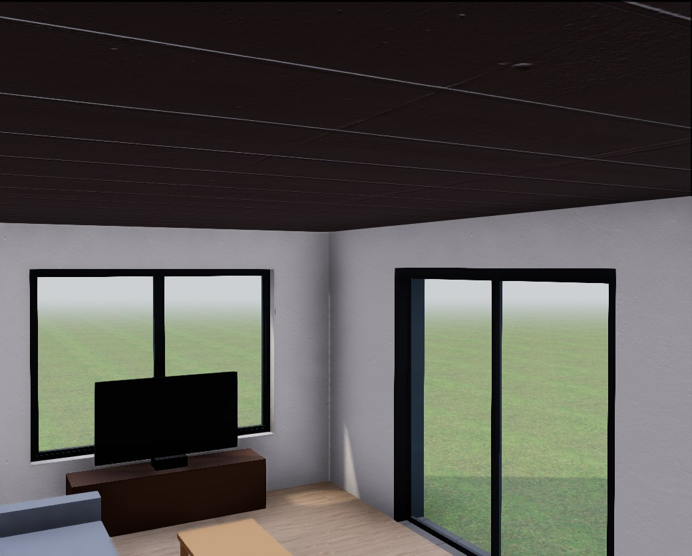 | 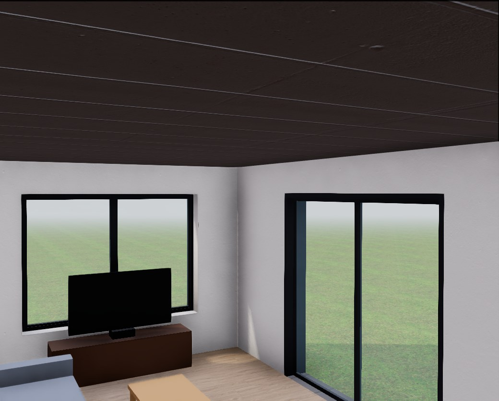 |

More after views: [site overview](after-site.jpg), [living room from above](after-living-top.jpg).

The bathroom looks the same before and after: Poly Haven has no CC0 sanitary ware, so toilet,
basin and shower keep their placeholders (TODO in `data/materials/ASSETS.md`).
