# Viewer screenshots — V4 facade grid

Headless Chromium (SwiftShader software WebGL), 1600×1000 window, canvas only, Exterior and Rear
camera presets. "Before" = `main` (layout@1.8.0); "after" = `v4-facade-grid` (layout@1.9.0).
Both sets were generated through the real product path
(`POST /api/v1/projects/{id}/generate` with the reference specs in `data/fixtures/specs`); the
stored versions record the engine versions.

| House | Before (layout@1.8.0) | After (layout@1.9.0) |
|---|---|---|
| 01 family house 280 m² | 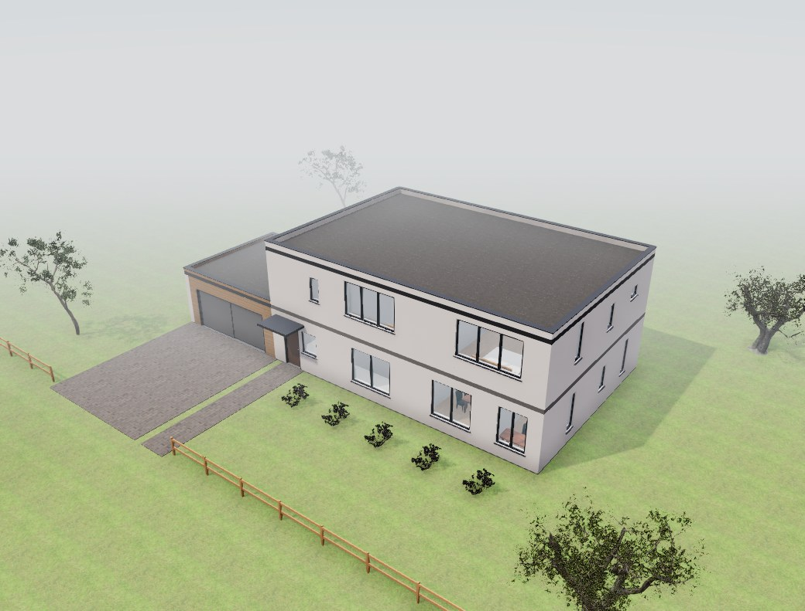 |  |
| 01 rear | 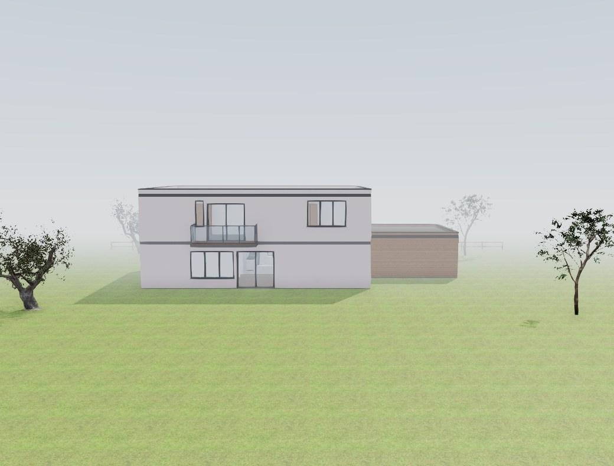 | 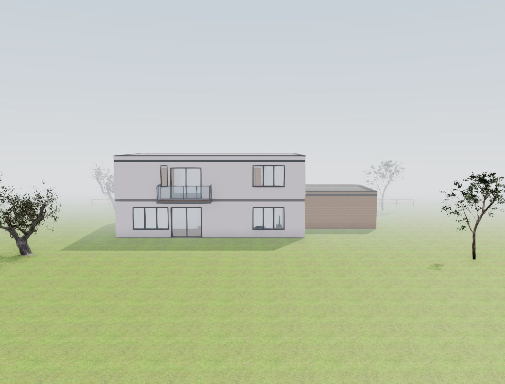 |
| 04 narrow-plot townhouse |  | 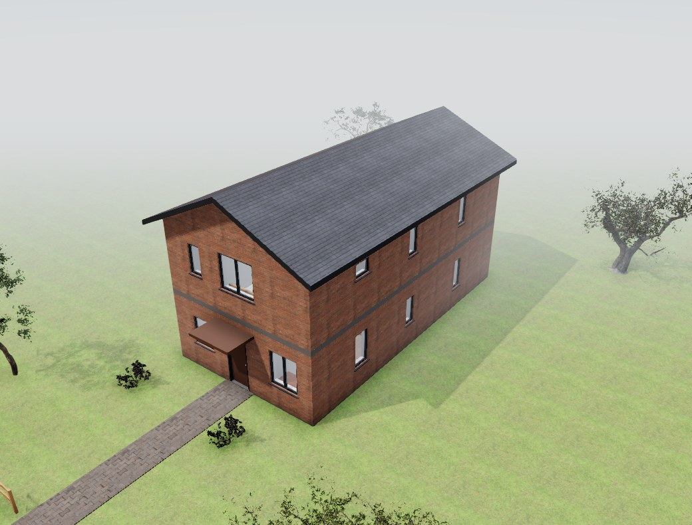 |
| 04 rear | 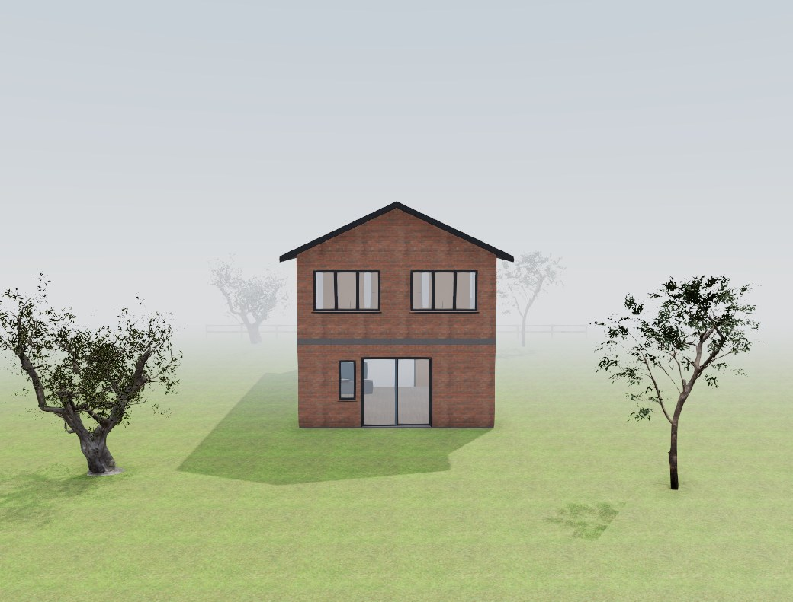 | 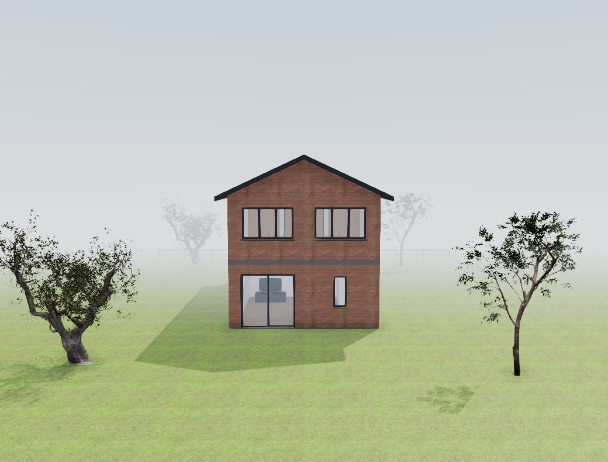 |
| 05 three-storey villa 360 m² |  | 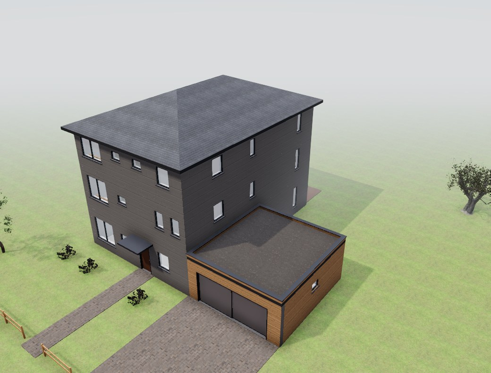 |
| 05 rear | 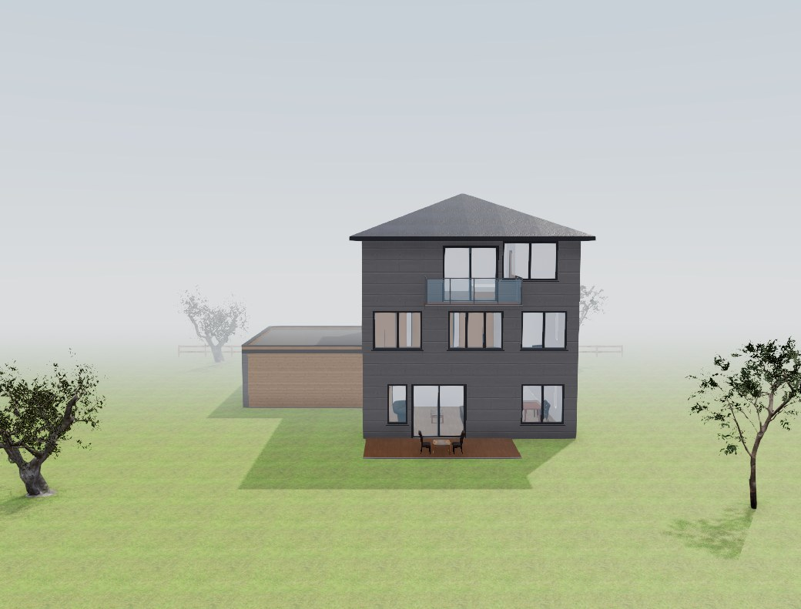 | 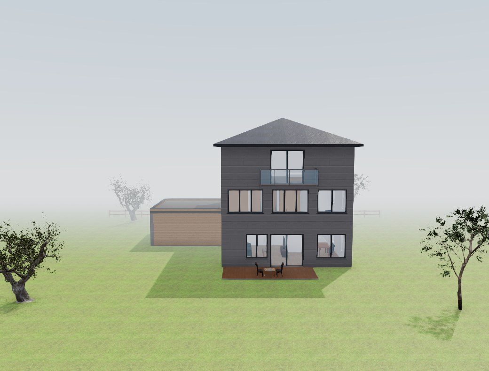 |
| 08 classic brick 220 m² |  | 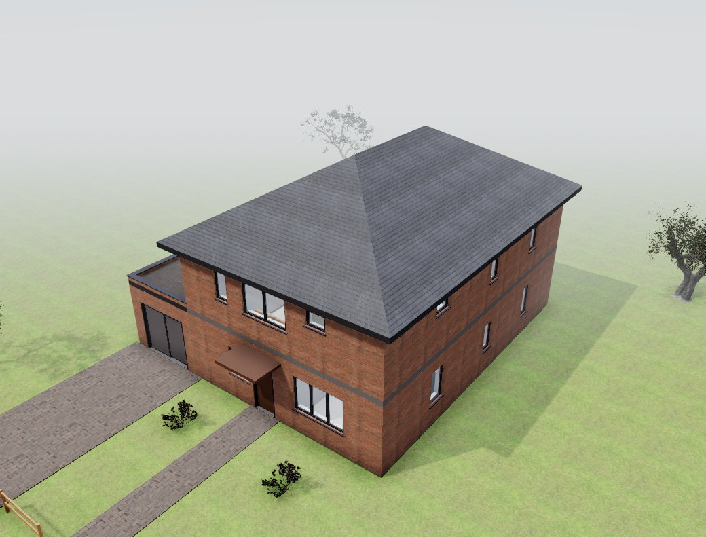 |
| 08 rear | 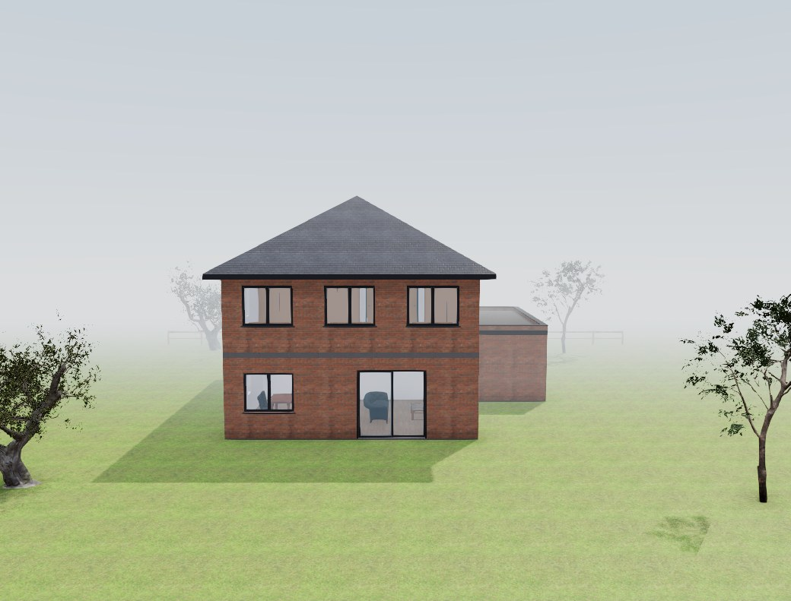 |  |

Upper exterior windows standing on a window below (measured on the model, 5 cm): 01 4→7/11,
04 5→7/9, 05 13→17/25, 08 4→6/11; all multi-storey reference specs 41/84 → 58/86.

What to look for: window columns across storeys (05 rear: three columns, the terrace door under
the balcony door), rhythm windows on the ground floor under the bedroom windows (01, 04), the
garden door under an upper window (04). 08's garden facade is unchanged: its sliding door cannot
stand on either bedroom axis at full width, so it stays centred between them.
